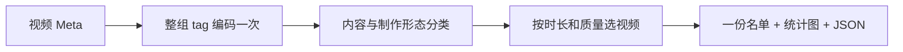

# Video Classify & Rebalance

对一份视频 Meta 做内容分类，再按时长、类目和技术要求选出交付名单。输入是 Parquet；输出包含 Parquet、JSON 和可离线打开的统计 HTML。



## 安装

Python 3.10 或以上，在仓库目录执行：

```bash
python -m venv .venv
source .venv/bin/activate
python -m pip install -e .
```

分类推理还需要 GPU 环境中的 PyTorch、Transformers 和本地 Qwen3-Embedding-4B 权重。已有环境可直接安装本包；新环境示例：

```bash
python -m pip install torch==2.9.1 --index-url https://download.pytorch.org/whl/cu128
python -m pip install 'transformers>=4.51,<5'
```

## 分类

输入至少包含 `tag` 或 `tags`。身份字段使用 `sample_id/source/source_uri`；缺列时分别从 `id/platform/url` 映射。其他原字段保留。

先准备自己的类目树、制作形态定义和本地模型。配置格式见 [输入输出说明](docs/input-output.md)。以下 `/data/...` 替换成实际路径。

```bash
python -m video_pipeline centers \
  --config /data/taxonomy.json --model /data/Qwen3-Embedding-4B \
  --output /data/centers

python -m video_pipeline classify \
  --input /data/meta.parquet --config /data/taxonomy.json \
  --centers /data/centers --forms /data/forms.json \
  --model /data/Qwen3-Embedding-4B --output /data/classified
```

每条视频的整组 tag 清洗后拼成一段文本，编码为完整 2560 维向量，同一向量分别匹配内容和制作形态。内容中心包含一级、二级及叶子节点；直接命中一级时，二级留空。没有有效 tag 的记录标为 `unclassified`。

输出 `classified.parquet`、`classified.json`、`hours-summary.json`、`report.json` 和 `statistics.html`。HTML 展示类目、形态和语种的小时分布。`--validate-only` 可检查配置与中心文件，不加载模型。

## 重平衡

在分类结果中准备好时长、大小、语言、分辨率等字段，再提供一份目标配置：

```bash
python -m video_pipeline rebalance \
  --input /data/classified/classified.parquet \
  --config /data/rebalance.json --output /data/selected

python -m video_pipeline audit --run /data/selected
```

目标都按同一个固定目标小时计算。求解依次考虑总时长、类目/形态/语种比例、技术指标、高分辨率比例，最后按密度和质量排序。每条视频只选一次；总体、各内容类目及制作形态的平均 `GiB ÷ 小时` 要在上限内。单条高密度视频可以与低密度视频搭配。

输出 `selected.parquet/json`、`statistics.html`、各项指标 JSON、独立审核结果和排除清单。打开 HTML 看图，查看 JSON 获取详细数字。`passed` 表示全部目标满足；运行完成但目标仍有差距时，报告保留每项实际值和缺口。

具体算法和输出字段见 [重平衡说明](docs/rebalancing.md)。

## 本地演示与验证

演示生成合成分类记录，不调用模型：

```bash
python examples/generate_demo.py /tmp/video-demo
python -m video_pipeline rebalance \
  --input /tmp/video-demo/classified.parquet \
  --config /tmp/video-demo/rebalance.json --output /tmp/video-selected
python -m unittest discover -s tests -v
```

仓库只包含代码、说明和合成数据生成器。类目、业务配额、模型、Meta 和运行输出放在外部目录。

本地验证结果见 [测试记录](docs/testing.md)。
